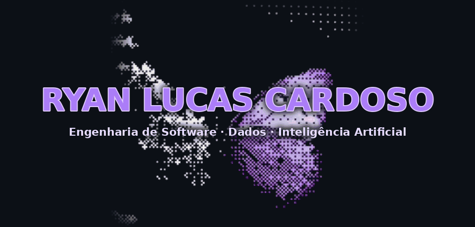
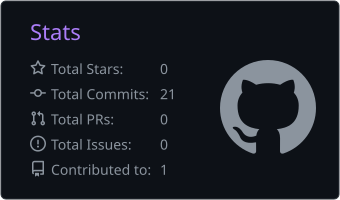

<!--
  Ryan Lucas Cardoso · github.com/RyanLucasC
  Paleta (dark): fundo #0d1117 · superfície #161b22 · borda #30363d
                 texto #e6edf3 / #c9d1d9 / #8b949e · acento #ab7df8 (uso pontual)
-->

Estudante de Engenharia de Software na UEM, construindo carreira em <b>Engenharia de Dados</b>.

<a href="#sobre">Sobre</a> &nbsp;·&nbsp;
<a href="#tech-stack">Tech Stack</a> &nbsp;·&nbsp;
<a href="#projetos">Projetos</a> &nbsp;·&nbsp;
<a href="#objetivos-2027">Objetivos</a> &nbsp;·&nbsp;
<a href="#roadmap-de-certificações">Certificações</a> &nbsp;·&nbsp;
<a href="#estatísticas">Estatísticas</a> &nbsp;·&nbsp;
<a href="#contato">Contato</a>

## Sobre

Graduando em **Engenharia de Software na UEM**, com foco no desenvolvimento de soluções de software e na análise de dados. Uno a visão técnica da tecnologia à aplicação prática em negócios e gestão de projetos.

Na **MAIN Empresa Júnior**, atuo na área Comercial e como Assistente de Projetos, cobrindo o ciclo de um serviço de tecnologia: da prospecção e negociação de contratos ao levantamento de requisitos e ao acompanhamento da entrega.

Na **RR Transportes e Terraplanagem**, aplico design de software e arquitetura web em sistemas internos e dashboards de gestão para fretes, abastecimento e custos operacionais.

Busco desafios que exijam pensamento analítico e conectem tecnologia a resultados reais.

## Tech Stack

<table>
<tr>
<td width="170"><b>LINGUAGENS</b></td>
<td>

</td>
</tr>
<tr>
<td width="170"><b>DADOS E BACKEND</b></td>
<td>

</td>
</tr>
<tr>
<td width="170"><b>WEB E DESIGN</b></td>
<td>

</td>
</tr>
<tr>
<td width="170"><b>CLOUD E FERRAMENTAS</b></td>
<td>

</td>
</tr>
</table>

## Projetos

<table>
<tr>
<td width="50%" valign="top">

**ERP Logístico**
 RR TRANSPORTES E TERRAPLANAGEM

Sistema de gestão de frota e operação de transporte: API em FastAPI com SQLite e migrações, painel web para o gestor e app PWA para o motorista, que funciona sem sinal.

- Viagens com conferência do gestor, DRE, comissões e custos de combustível, manutenção e gastos avulsos com foto de recibo
- Frete comparado ao piso mínimo da ANTT, com tabelas versionadas e atualizadas pela calculadora oficial
- Alertas de vencimento e de manutenção por km, com notificações push
- Auditoria de alterações, backup diário cifrado e teste semanal de restauração
- Segurança: senhas com scrypt, sessões revogáveis, bloqueio por tentativas e CSP restritiva
- Testes automatizados (pytest e Playwright) e CI no GitHub Actions, com verificação de dependências
- Em produção em VPS Linux, com Caddy (HTTPS) e systemd

 

</td>
<td width="50%" valign="top">

**MAIN Empresa Júnior**
 COMERCIAL E PROJETOS · UEM

Atuação dupla na área Comercial e como Assistente de Projetos, cobrindo o ciclo de um serviço de tecnologia, da prospecção à entrega.

- Prospecção de clientes e negociação de contratos
- Levantamento e estruturação de requisitos
- Planejamento e acompanhamento da execução dos projetos

 

</td>
</tr>
<tr>
<td colspan="2" valign="top">

**Próximos projetos**
 EM PREPARAÇÃO

Pipelines de dados, IA aplicada e cloud na AWS. Os repositórios públicos serão listados aqui conforme forem publicados.

 

</td>
</tr>
</table>

## Objetivos 2027

<table>
<tr><td>Colocar o ERP logístico da RR Transportes em produção</td><td align="right"></td></tr>
<tr><td>Certificação AWS Cloud Practitioner</td><td align="right"></td></tr>
<tr><td>Fundamentos de IA e Machine Learning</td><td align="right"></td></tr>
<tr><td>Primeiros pipelines de Engenharia de Dados</td><td align="right"></td></tr>
<tr><td>Comunidade tech de cloud na UEM</td><td align="right"></td></tr>
<tr><td>Projetos open source no GitHub</td><td align="right"></td></tr>
</table>

## Roadmap de certificações

**Certificações-alvo (AWS)**

<table>
<tr><td><b>AWS Certified Cloud Practitioner</b></td><td align="right"></td></tr>
<tr><td><b>AWS Certified AI Practitioner</b></td><td align="right"></td></tr>
<tr><td><b>AWS Certified Data Engineer – Associate</b></td><td align="right"></td></tr>
<tr><td><b>AWS Certified Solutions Architect – Associate</b></td><td align="right"></td></tr>
</table>

**Trilha de estudos**

<table>
<tr>
<td width="170" valign="top"><b>Fase 01</b> Linux, Cloud e IA</td>
<td valign="top">LFS101 Linux · AWS Cloud Practitioner Essentials · SimuLearn Cloud Practitioner · Claude Academy</td>
<td align="right" valign="top"></td>
</tr>
<tr>
<td width="170" valign="top"><b>Fase 02</b> Fundamentos AWS</td>
<td valign="top">Cloud Essentials Knowledge Badge</td>
<td align="right" valign="top"></td>
</tr>
<tr>
<td width="170" valign="top"><b>Fase 03</b> Dados</td>
<td valign="top">Databricks Fundamentals · dbt Fundamentals · Cisco Data Analytics Essentials</td>
<td align="right" valign="top"></td>
</tr>
<tr>
<td width="170" valign="top"><b>Fase 04</b> Inteligência Artificial</td>
<td valign="top">SimuLearn AI Practitioner · Databricks Generative AI · Databricks AI Agent</td>
<td align="right" valign="top"></td>
</tr>
<tr>
<td width="170" valign="top"><b>Fase 05</b> DevOps e Segurança</td>
<td valign="top">LFS158 Kubernetes · LFS162 DevOps e SRE · Cisco Cybersecurity</td>
<td align="right" valign="top"></td>
</tr>
<tr>
<td width="170" valign="top"><b>Fase 06</b> Treino AWS</td>
<td valign="top">Cloud Quest Cloud Practitioner · Cloud Quest Gen AI Practitioner</td>
<td align="right" valign="top"></td>
</tr>
</table>

## Estatísticas

## Contato

Aberto a projetos, estágios e colaborações.

UEM &nbsp;·&nbsp; Maringá, PR &nbsp;·&nbsp; Engenharia de Software

