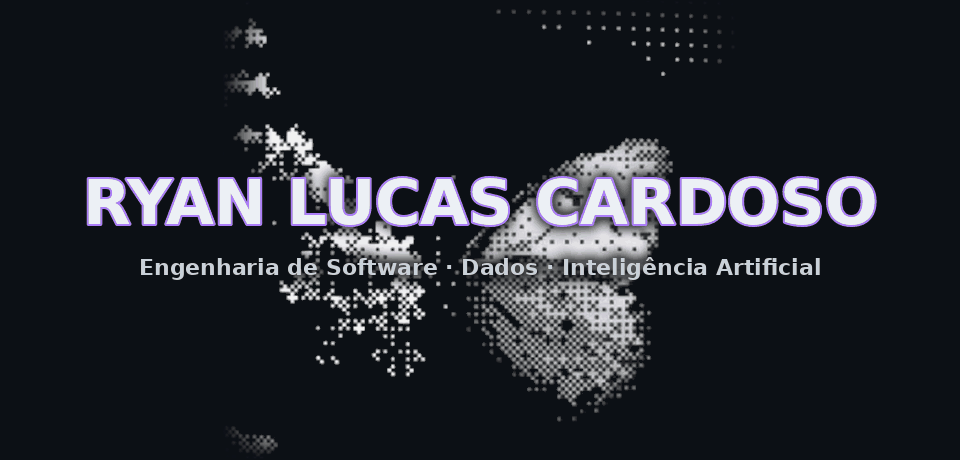

<!--
  Ryan Lucas Cardoso · github.com/RyanLucasC
  Paleta (dark): fundo #0d1117 · superfície #161b22 · borda #30363d
                 texto #e6edf3 / #c9d1d9 / #8b949e · acento #ab7df8 (uso pontual)
-->

Estudante de Engenharia de Software na UEM, construindo carreira em <b>Engenharia de Dados</b>.

<a href="#sobre">Sobre</a> &nbsp;·&nbsp;
<a href="#tech-stack">Tech Stack</a> &nbsp;·&nbsp;
<a href="#projetos">Projetos</a> &nbsp;·&nbsp;
<a href="#objetivos-2026">Objetivos</a> &nbsp;·&nbsp;
<a href="#certificações">Certificações</a> &nbsp;·&nbsp;
<a href="#estatísticas">Estatísticas</a> &nbsp;·&nbsp;
<a href="#contato">Contato</a>

## Sobre

Estudante de **Engenharia de Software na UEM**, com foco em **Engenharia de Dados**. Trabalho com Python, bancos de dados, dashboards web e integração com IA, e já configurei um servidor Linux (VPS), com HTTPS automático (Caddy) e serviços no systemd, para rodar a API do ERP.

Na **MAIN Empresa Júnior** acompanho o ciclo completo de um projeto, do comercial à entrega. Na **RR Transportes e Terraplanagem** desenvolvo sistemas internos para logística de grãos e calcário e gestão de frota. Meu objetivo é construir sistemas a partir de problemas reais de operação.

<table>
<tr><td width="150"><b>FORMAÇÃO</b></td><td>Engenharia de Software · Universidade Estadual de Maringá (UEM)</td></tr>
<tr><td><b>FOCO</b></td><td>Engenharia de Dados · Inteligência Artificial · Arquitetura de Software · Cloud (AWS)</td></tr>
<tr><td><b>ATUAÇÃO</b></td><td>Operações e Projetos, MAIN Empresa Júnior Operações e Sistemas, RR Transportes e Terraplanagem</td></tr>
<tr><td><b>BASE</b></td><td>Maringá, PR — Brasil</td></tr>
</table>

## Tech Stack

<table>
<tr>
<td width="150"><b>LINGUAGENS</b></td>
<td>

</td>
</tr>
<tr>
<td><b>BACKEND</b></td>
<td>

</td>
</tr>
<tr>
<td><b>WEB</b></td>
<td>

</td>
</tr>
<tr>
<td><b>DADOS E IA</b></td>
<td>

</td>
</tr>
<tr>
<td><b>CLOUD E INFRA</b></td>
<td>

</td>
</tr>
<tr>
<td><b>FERRAMENTAS</b></td>
<td>

</td>
</tr>
</table>

## Projetos

<table>
<tr>
<td width="50%" valign="top">

**ERP Logístico**
 RR TRANSPORTES E TERRAPLANAGEM

Sistema de gestão de frota e operação de transporte: API em FastAPI com SQLite e migrações, painel web para o gestor e app PWA para o motorista, que funciona sem sinal.

- Viagens com DRE, comissões e custos de combustível e manutenção
- Frete comparado ao piso mínimo da ANTT, com tabelas versionadas
- Alertas de vencimento e de manutenção por km, com notificações push
- Auditoria de alterações, backup diário cifrado e teste semanal de restauração
- Testes automatizados (pytest e Playwright) e CI no GitHub Actions
- Deploy em VPS Linux com Caddy (HTTPS) e systemd

 

</td>
<td width="50%" valign="top">

**MAIN Empresa Júnior**
 OPERAÇÕES E PROJETOS · UEM

Atuação no ciclo de vida completo de soluções para clientes reais: prospecção, escopo, execução e entrega de projetos de tecnologia.

 

</td>
</tr>
<tr>
<td colspan="2" valign="top">

**Próximos projetos**
 EM PREPARAÇÃO

Pipelines de dados, IA aplicada e cloud na AWS. Os repositórios públicos serão listados aqui conforme forem publicados.

 

</td>
</tr>
</table>

## Objetivos 2026

<table>
<tr><td>Colocar o ERP logístico da RR Transportes em produção</td><td align="right"></td></tr>
<tr><td>Certificação AWS Cloud Practitioner</td><td align="right"></td></tr>
<tr><td>Fundamentos de IA e Machine Learning</td><td align="right"></td></tr>
<tr><td>Primeiros pipelines de Engenharia de Dados</td><td align="right"></td></tr>
<tr><td>Comunidade tech de cloud na UEM</td><td align="right"></td></tr>
<tr><td>Projetos open source no GitHub</td><td align="right"></td></tr>
</table>

## Certificações

<!-- Atualize o número conforme for concluindo: troque 0 pelo total de badges obtidos -->

<table>
<tr>
<td width="200" valign="top"><b>Fase 01</b> Linux e Cloud</td>
<td valign="top">
<a href="https://training.linuxfoundation.org/training/introduction-to-linux/">LFS101 Linux</a> 
<a href="https://skillbuilder.aws/learning-plan/EKHCUEWUUC/aws-simulearn-cloud-practitioner/1UQVR262ZB">SimuLearn Cloud Practitioner</a>
</td>
<td align="right" valign="top"></td>
</tr>
<tr>
<td valign="top"><b>Fase 02</b> Fundamentos AWS</td>
<td valign="top">
<a href="https://skillbuilder.aws/learn/63URRERNTS/cloud-essentials-knowledge-badge-assessment/VYB4663QV9">Cloud Essentials Knowledge Badge</a>
</td>
<td align="right" valign="top"></td>
</tr>
<tr>
<td valign="top"><b>Fase 03</b> Dados</td>
<td valign="top">
<a href="https://www.databricks.com/resources/learn/training/databricks-fundamentals">Databricks Fundamentals</a> 
<a href="https://learn.getdbt.com">dbt Fundamentals</a> 
<a href="https://www.netacad.com/courses/data-analytics-essentials?courseLang=en-US">Cisco Data Analytics Essentials</a>
</td>
<td align="right" valign="top"></td>
</tr>
<tr>
<td valign="top"><b>Fase 04</b> Inteligência Artificial</td>
<td valign="top">
<a href="https://skillbuilder.aws/learning-plan/3HCD821CNZ/aws-simulearn-ai-practitioner/BFKGA5VM8H">SimuLearn AI Practitioner</a> 
<a href="https://www.databricks.com/resources/learn/training/generative-ai-fundamentals">Databricks Generative AI</a> 
<a href="https://www.databricks.com/resources/training/level-your-ai-agent-skills">Databricks AI Agent</a>
</td>
<td align="right" valign="top"></td>
</tr>
<tr>
<td valign="top"><b>Fase 05</b> DevOps, Segurança e Streaming</td>
<td valign="top">
<a href="https://training.linuxfoundation.org/training/introduction-to-kubernetes/">LFS158 Kubernetes</a> 
<a href="https://training.linuxfoundation.org/training/introduction-to-devops-and-site-reliability-engineering-lfs162/">LFS162 DevOps e SRE</a> 
<a href="https://www.netacad.com/courses/introduction-to-cybersecurity?courseLang=en-US">Cisco Cybersecurity</a> 
<a href="https://www.confluent.io/training/">Confluent Kafka Fundamentals</a>
</td>
<td align="right" valign="top"></td>
</tr>
<tr>
<td valign="top"><b>Fase 06</b> Treino e Certificações AWS</td>
<td valign="top">
<a href="https://skillbuilder.aws/learn/FU5WCYVGKY/aws-cloud-quest-cloud-practitioner/JF9TKU68GT">Cloud Quest Cloud Practitioner</a> 
<a href="https://skillbuilder.aws/learn/5YB3FCEE1H/aws-cloud-quest-generative-ai-practitioner/26A81MG83V">Cloud Quest Gen AI Practitioner</a> 
<a href="https://aws.amazon.com/certification/certified-cloud-practitioner/">AWS Certified Cloud Practitioner</a> 
<a href="https://aws.amazon.com/certification/certified-ai-practitioner/">AWS Certified AI Practitioner</a>
</td>
<td align="right" valign="top"></td>
</tr>
</table>

## Estatísticas

## Contato

Aberto a projetos, estágios e colaborações.

UEM &nbsp;·&nbsp; Maringá, PR &nbsp;·&nbsp; Engenharia de Software

