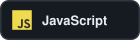

<!--
  Ryan Lucas Cardoso · github.com/RyanLucasC
  Paleta (dark): fundo #0d1117 · superfície #161b22 · borda #30363d
                 texto #e6edf3 / #c9d1d9 / #8b949e · acento #ab7df8 (uso pontual)
-->

Estudante de Engenharia de Software na UEM, com foco em **Engenharia de Dados**, cloud e IA.

## Agora

- **RR Transportes e Terraplanagem** · atuo em operações; desenvolvi o ERP de gestão de frota que a empresa usa hoje
- **Main - Soluções em Software** · estágio na Área Comercial e como Assistente de Projetos
- **PIBIC na UEM** · pesquisa com Teoria de Resposta ao Item (TRI) e IA
- **Cloud Native Maringá (CNCF)** · co-organizador da comunidade local, que vai levar eventos de cloud à UEM a partir de 2027
- **AWS Certified Cloud Practitioner** · em preparação

## Projetos

**ERP Logístico** · em produção na RR Transportes e Terraplanagem
 A transportadora não tinha controle real do dinheiro que entrava e saía: 9 caminhões e cerca de 85 viagens por mês controlados em planilhas, papel e WhatsApp. Desenvolvi o sistema que hoje organiza viagens, custos e fretes, com painel para o gestor e app para o motorista, que funciona sem sinal.
 **Resultado:** a conferência do financeiro no dia do pagamento caiu de 8 para 3 horas, ou seja, 62,5% menos tempo.
 FastAPI · SQLite · PWA offline · testes com pytest e Playwright · CI no GitHub Actions · VPS Linux com nginx e HTTPS

**Portfólio** · resume as code
 Site bilíngue e currículo em PDF de uma página, gerados a partir de um único arquivo de dados. O build bloqueia a publicação se encontrar dado sensível. Sem JavaScript, com nota 100 no Lighthouse.

 

## Stack

Aberto a oportunidades de estágio em dados, cloud ou desenvolvimento &nbsp;·&nbsp; Maringá, PR

