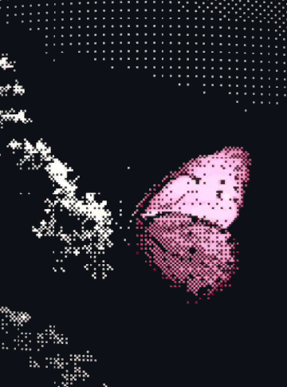
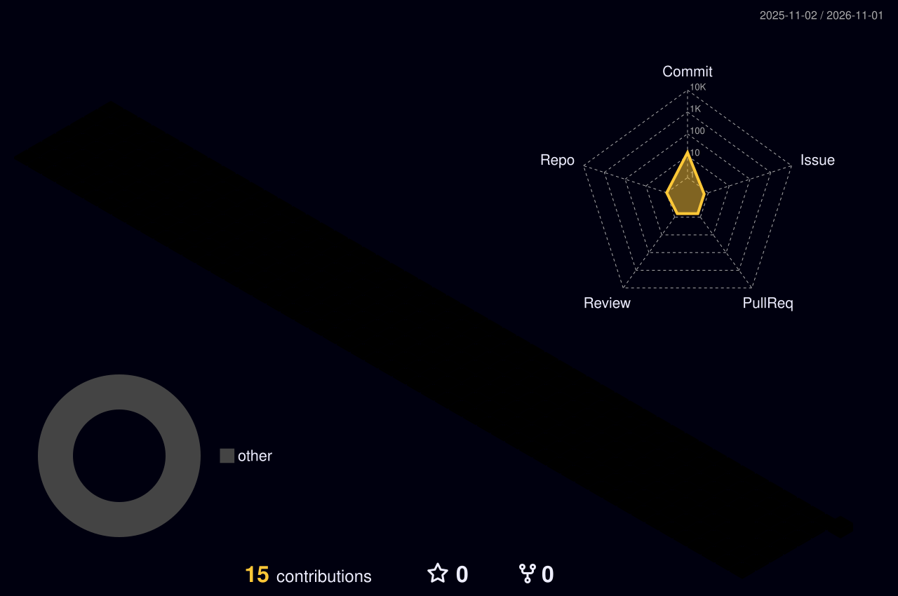

<!-- ═════════════════════════════════════════════════════════════════════
     ◢◤  R.Y.A.N  //  NEURAL PROFILE INTERFACE  //  v2026.10  ◥◣
     github.com/RyanLucasC
     ═════════════════════════════════════════════════════════════════════ -->

<div align="center">

<!-- ░░░ BANNER PRINCIPAL · borboleta ASCII ░░░ -->





<!-- ░░░ SEQUÊNCIA DE BOOT ░░░ -->


<!-- ░░░ TYPING ANIMATION ░░░ -->


<br/>


</div>


<!-- ═════════════════════ 01 · SOBRE MIM ═════════════════════ -->
## 

<table>
<tr>
<td width="60%" valign="top">

```python
class RyanLucasCardoso:
    def __init__(self):
        self.base      = "Maringá, PR — Brasil 🇧🇷"
        self.education = "Engenharia de Software @ UEM"
        self.roles     = [
            "Operações & Projetos @ MAIN Empresa Júnior",
            "Operações & Sistemas @ RR Transportes e Terraplanagem",
        ]
        self.focus     = ["Engenharia de Dados",
                          "Inteligência Artificial",
                          "Arquitetura de Software",
                          "Cloud (AWS)"]

    def mission(self):
        return "Transformar operações reais em sistemas inteligentes."
```

</td>
<td width="40%" valign="middle">

Estudante de **Engenharia de Software na UEM**, conectando desenvolvimento, dados e IA a problemas do mundo real.

Na **MAIN Empresa Júnior** vivo o ciclo completo de um projeto — do comercial à entrega. Na **RR Transportes** construo sistemas internos para logística de grãos, calcário e gestão de frota.

⚡ Movido a **cloud**, código bem feito e café.

</td>
</tr>
</table>

<!-- ═════════════════════ 02 · TECH STACK ═════════════════════ -->
## 

<div align="center">

<sub><code>// LINGUAGENS & WEB</code></sub>
<br/><br/>


<br/><br/>

<sub><code>// CLOUD & SISTEMA</code></sub>
<br/><br/>


<br/><br/>

<sub><code>// DADOS & IA</code></sub>
<br/><br/>


</div>

<!-- ═════════════════════ 03 · FERRAMENTAS ═════════════════════ -->
## 

<div align="center">


<br/><br/>


</div>

<!-- ═════════════════════ 04 · PROJETOS ═════════════════════ -->
## 

<div align="center">
<table>
<tr>
<td width="50%" valign="top">

<h3>🚛 ERP Logístico</h3>
<sub><code>RR TRANSPORTES E TERRAPLANAGEM</code></sub>

<p>Sistema interno de gestão de operações de transporte: controle de custos de combustível, cálculo de fretes e logística de grãos e calcário, com regras de negócio complexas em uma interface simples.</p>


<br/><br/>


</td>
<td width="50%" valign="top">

<h3>💼 MAIN Empresa Júnior</h3>
<sub><code>OPERAÇÕES & PROJETOS · UEM</code></sub>

<p>Atuação no ciclo de vida completo de soluções para clientes reais — prospecção, escopo, execução e entrega de projetos de tecnologia.</p>


<br/><br/>


</td>
</tr>
<tr>
<td colspan="2" align="center" valign="top">

<h3>🧠 Próximo Deploy</h3>
<sub><code>SLOT RESERVADO</code></sub>

<p>Pipelines de dados, IA aplicada e cloud na AWS. Os próximos repositórios públicos vão aparecer aqui — acompanhe o perfil.</p>


<br/><br/>


</td>
</tr>
</table>
</div>

<!-- ═════════════════════ 05 · OBJETIVOS ═════════════════════ -->
## 

```bash
ryan@neural-core:~$ ./mission_control --list --year=2026

  ╔════════════════════════════════════════════════════════════╗
  ║   ◢◤  MISSION CONTROL  ::  ROADMAP ATIVO                    ║
  ╚════════════════════════════════════════════════════════════╝

  [ RUNNING ]  🚛  Colocar o ERP logístico da RR Transportes em produção
  [ RUNNING ]  ☁️   Certificação AWS Cloud Practitioner
  [ RUNNING ]  🧠  Fundamentos de IA & Machine Learning
  [ QUEUED  ]  📊  Primeiros pipelines de Engenharia de Dados
  [ QUEUED  ]  🚀  Fortalecer a comunidade tech de cloud na UEM
  [ QUEUED  ]  🌍  Publicar projetos open source no GitHub

ryan@neural-core:~$ echo $NEXT_DIRECTIVE
>> Ready to build, analyze and deploy. 🔥

ryan@neural-core:~$ █
```

<!-- ═════════════════════ 06 · CERTIFICAÇÕES ═════════════════════ -->
## 

<div align="center">

<!-- Atualize o número conforme for concluindo: troque 0 pelo total de badges obtidos -->


<br/><br/>

<table>
<tr>
<td width="24%" align="center"><code>FASE 01</code><br/><sub><b>Linux & Cloud</b></sub><br/><br/></td>
<td width="76%" align="center">
<a href="https://training.linuxfoundation.org/training/introduction-to-linux/"></a>
<a href="https://skillbuilder.aws/learning-plan/EKHCUEWUUC/aws-simulearn-cloud-practitioner/1UQVR262ZB"></a>
</td>
</tr>
<tr>
<td width="24%" align="center"><code>FASE 02</code><br/><sub><b>Fundamentos AWS</b></sub><br/><br/></td>
<td width="76%" align="center">
<a href="https://skillbuilder.aws/learn/63URRERNTS/cloud-essentials-knowledge-badge-assessment/VYB4663QV9"></a>
</td>
</tr>
<tr>
<td width="24%" align="center"><code>FASE 03</code><br/><sub><b>Dados</b></sub><br/><br/></td>
<td width="76%" align="center">
<a href="https://www.databricks.com/resources/learn/training/databricks-fundamentals"></a>
<a href="https://learn.getdbt.com"></a>
<a href="https://www.netacad.com/courses/data-analytics-essentials?courseLang=en-US"></a>
</td>
</tr>
<tr>
<td width="24%" align="center"><code>FASE 04</code><br/><sub><b>Inteligência Artificial</b></sub><br/><br/></td>
<td width="76%" align="center">
<a href="https://skillbuilder.aws/learning-plan/3HCD821CNZ/aws-simulearn-ai-practitioner/BFKGA5VM8H"></a>
<a href="https://www.databricks.com/resources/learn/training/generative-ai-fundamentals"></a>
<a href="https://www.databricks.com/resources/training/level-your-ai-agent-skills"></a>
</td>
</tr>
<tr>
<td width="24%" align="center"><code>FASE 05</code><br/><sub><b>DevOps · Segurança · Streaming</b></sub><br/><br/></td>
<td width="76%" align="center">
<a href="https://training.linuxfoundation.org/training/introduction-to-kubernetes/"></a>
<a href="https://training.linuxfoundation.org/training/introduction-to-devops-and-site-reliability-engineering-lfs162/"></a>
<a href="https://www.netacad.com/courses/introduction-to-cybersecurity?courseLang=en-US"></a>
<a href="https://www.confluent.io/training/"></a>
</td>
</tr>
<tr>
<td width="24%" align="center"><code>FASE 06</code><br/><sub><b>Treino & Certificações AWS</b></sub><br/><br/></td>
<td width="76%" align="center">
<a href="https://skillbuilder.aws/learn/FU5WCYVGKY/aws-cloud-quest-cloud-practitioner/JF9TKU68GT"></a>
<a href="https://skillbuilder.aws/learn/5YB3FCEE1H/aws-cloud-quest-generative-ai-practitioner/26A81MG83V"></a>
<a href="https://aws.amazon.com/certification/certified-cloud-practitioner/"></a>
<a href="https://aws.amazon.com/certification/certified-ai-practitioner/"></a>
</td>
</tr>
</table>


</div>

<!-- ═════════════════════ 07 · ANALYTICS ═════════════════════ -->
## 

<div align="center">


</div>

<!-- ═════════════════════ 08 · CONTRIBUIÇÕES 3D ═════════════════════ -->
## 

<div align="center">



</div>

<!-- ═════════════════════ 09 · CONEXÃO ═════════════════════ -->
## 

<div align="center">

<a href="https://www.linkedin.com/in/ryanlucascardoso/"></a>
<a href="https://github.com/RyanLucasC"></a>

<br/><br/>


</div>

<!-- ═════════════════════ RODAPÉ ═════════════════════ -->


<div align="center">

<sub>◢◤ &nbsp; SESSION ACTIVE &nbsp;·&nbsp; UEM · MARINGÁ, PR &nbsp;·&nbsp; ENGINEERING THE ARCHITECTURE OF TOMORROW &nbsp; ◥◣</sub>


</div>